# UML Class Diagram & Architecture Specification

**Project**: Digital Circuit & Logic Gate Simulator (C++17)  
**Specification**: Object Oriented Programming Project  

---

## 1. Complete Mermaid Class Diagram

```mermaid
classDiagram
    direction TB

    %% Enums and Helpers
    class LogicState {
        <<enumeration>>
        LOW = 0
        HIGH = 1
        UNKNOWN = 2
    }

    class LogicHelpers {
        <<utility>>
        +toChar(LogicState) char
        +toString(LogicState) string
        +fromBool(bool) LogicState
        +logicNot(LogicState) LogicState
        +logicAnd(LogicState, LogicState) LogicState
        +logicOr(LogicState, LogicState) LogicState
        +logicXor(LogicState, LogicState) LogicState
    }

    %% Encapsulation
    class Wire {
        -string m_name
        -LogicState m_state
        -bool m_isPrimaryInput
        -bool m_isPrimaryOutput
        -bool m_hasDriver
        +Wire(string name)
        +getName() const string&
        +getState() const LogicState
        +setState(LogicState newState) bool
        +isPrimaryInput() const bool
        +setPrimaryInput(bool isInput) void
        +isPrimaryOutput() const bool
        +setPrimaryOutput(bool isOutput) void
        +hasDriver() const bool
        +setDriver(bool driven) void
        +reset() void
    }

    %% Abstraction & Template Method
    class Gate {
        <<abstract>>
        #string m_id
        #vector~shared_ptr~Wire~~ m_inputs
        #shared_ptr~Wire~ m_output
        +Gate(string id, vector~shared_ptr~Wire~~ inputs, shared_ptr~Wire~ output)
        +virtual ~Gate()
        +evaluate() bool
        +getId() const string&
        +getInputs() const vector~shared_ptr~Wire~~&
        +getOutput() const shared_ptr~Wire~&
        +virtual compute() const LogicState*
        +virtual getTypeName() const string*
        +virtual minInputs() const size_t
        +virtual maxInputs() const size_t
    }

    %% Inheritance & Polymorphism
    class ANDGate {
        +ANDGate(string id, vector inputs, shared_ptr output)
        +compute() const LogicState
        +getTypeName() const string
    }

    class ORGate {
        +ORGate(string id, vector inputs, shared_ptr output)
        +compute() const LogicState
        +getTypeName() const string
    }

    class NOTGate {
        +NOTGate(string id, vector inputs, shared_ptr output)
        +compute() const LogicState
        +getTypeName() const string
        +minInputs() const size_t
        +maxInputs() const size_t
    }

    class NANDGate {
        +NANDGate(string id, vector inputs, shared_ptr output)
        +compute() const LogicState
        +getTypeName() const string
    }

    class NORGate {
        +NORGate(string id, vector inputs, shared_ptr output)
        +compute() const LogicState
        +getTypeName() const string
    }

    class XORGate {
        +XORGate(string id, vector inputs, shared_ptr output)
        +compute() const LogicState
        +getTypeName() const string
    }

    class XNORGate {
        +XNORGate(string id, vector inputs, shared_ptr output)
        +compute() const LogicState
        +getTypeName() const string
    }

    Gate <|-- ANDGate
    Gate <|-- ORGate
    Gate <|-- NOTGate
    Gate <|-- NANDGate
    Gate <|-- NORGate
    Gate <|-- XORGate
    Gate <|-- XNORGate

    %% Factory Pattern
    class GateFactory {
        <<service>>
        -map~string, CreatorFunc~ s_registry$
        +create(string type, string id, vector inputs, shared_ptr output)$ shared_ptr~Gate~
        +registerGateType(string type, CreatorFunc creator)$ void
        +isKnownType(string type)$ bool
    }

    %% Composition
    class Circuit {
        -map~string, shared_ptr~Wire~~ m_wires
        -vector~shared_ptr~Gate~~ m_gates
        -vector~string~ m_primaryInputs
        -vector~string~ m_primaryOutputs
        -size_t m_lastPassCount
        -detectCycles() const void
        +Circuit()
        +~Circuit()
        +addWire(string name) shared_ptr~Wire~
        +getWire(string name) const shared_ptr~Wire~
        +hasWire(string name) const bool
        +addGate(shared_ptr~Gate~ gate) void
        +declareInput(string name) void
        +declareOutput(string name) void
        +setInput(string name, LogicState state) void
        +resetAll() void
        +validate() const void
        +simulate(bool verbose, ostream out) size_t
        +getLastPassCount() const size_t
        +getOutputs() const vector~pair~string, LogicState~~
        +getPrimaryInputs() const vector~string~&
        +getPrimaryOutputs() const vector~string~&
        +getWires() const map~string, shared_ptr~Wire~~&
        +getGates() const vector~shared_ptr~Gate~~&
    }

    %% Parser & Generator
    class NetlistParser {
        <<utility>>
        +parseFile(string path)$ Circuit
        +parseStream(istream in, string sourceName)$ Circuit
        -isValidIdentifier(string ident)$ bool
        -toUpper(string str)$ string
        -trim(string str)$ string
    }

    class TruthTableGenerator {
        -Circuit& m_circuit
        -computeAllRows() vector~TableRow~
        +TruthTableGenerator(Circuit circuit)
        +printTable(ostream out) void
        +exportCsv(string csvPath) void
    }

    %% Exception Hierarchy
    class runtime_error {
        <<std::runtime_error>>
    }

    class SimulatorException {
        +SimulatorException(string message)
    }

    class NetlistParseException {
        -string m_fileName
        -size_t m_lineNumber
        -string m_rawMessage
        +NetlistParseException(string file, size_t line, string msg)
        +getFileName() const string&
        +getLineNumber() const size_t
        +getRawMessage() const string&
    }

    class UnknownGateTypeException {
        -string m_gateType
        +UnknownGateTypeException(string file, size_t line, string type)
        +UnknownGateTypeException(string type)
        +getGateType() const string&
    }

    class CircuitInstabilityException {
        +CircuitInstabilityException(string message)
    }

    class UnconnectedPinException {
        +UnconnectedPinException(string message)
    }

    class MultipleDriverException {
        +MultipleDriverException(string message)
    }

    class IllegalSignalStateException {
        +IllegalSignalStateException(string message)
    }

    runtime_error <|-- SimulatorException
    SimulatorException <|-- NetlistParseException
    NetlistParseException <|-- UnknownGateTypeException
    SimulatorException <|-- CircuitInstabilityException
    SimulatorException <|-- UnconnectedPinException
    SimulatorException <|-- MultipleDriverException
    SimulatorException <|-- IllegalSignalStateException

    %% Relationships
    Wire ..> LogicState : uses
    Gate --> Wire : inputs & output associations
    Gate ..> LogicState : computes state
    Circuit *-- Wire : owns (Composition)
    Circuit *-- Gate : owns (Composition)
    TruthTableGenerator o-- Circuit : references
    NetlistParser ..> Circuit : produces
    NetlistParser ..> GateFactory : uses
    GateFactory ..> Gate : instantiates
```

---

## 2. Object-Oriented Design Pillars in Detail

### 1. Encapsulation
- **Implementation**: The [`Wire`](../include/Wire.h) class encapsulates internal signal state (`m_state`), driver status (`m_hasDriver`), and circuit boundary designations (`m_isPrimaryInput`, `m_isPrimaryOutput`).
- **Data Integrity**: State can only be updated via `setState(LogicState)`, which checks for an actual state change and returns a boolean dirty-flag. This prevents external tampering and allows the simulation engine to track convergence cleanly.

### 2. Abstraction
- **Implementation**: The [`Gate`](../include/Gate.h) abstract base class defines a unified contract for any digital logic gate.
- **Template Method Pattern**: The public method `evaluate()` defines the fixed algorithm for gate settling (invoking `compute()`, applying the new state to the output wire, and detecting changes). Concrete logic gates only implement the functional customization point: `virtual LogicState compute() const = 0`.

### 3. Inheritance
- **Implementation**: Concrete gates ([`ANDGate`](../include/Gates.h), [`ORGate`](../include/Gates.h), [`NOTGate`](../include/Gates.h), [`NANDGate`](../include/Gates.h), [`NORGate`](../include/Gates.h), [`XORGate`](../include/Gates.h), [`XNORGate`](../include/Gates.h)) inherit common fields (`m_id`, `m_inputs`, `m_output`) and methods from `Gate`.
- **Exception Hierarchy**: [`SimulatorException`](../include/Exceptions.h) inherits from `std::runtime_error`, while specialized domain exceptions inherit from `SimulatorException`.

### 4. Polymorphism
- **Dynamic Dispatch**: The circuit engine holds gates as a collection of base-class pointers: `std::vector<std::shared_ptr<Gate>> m_gates`. During multi-pass simulation, `gate->evaluate()` is invoked on each element, dynamically executing the specialized `compute()` implementation without runtime type branching.
- **Extensible Factory**: [`GateFactory`](../include/Gates.h) provides a registration mechanism (`std::map<std::string, CreatorFunc>`). New gate types can be registered without modifying existing parser or circuit code (Open/Closed Principle).

### 5. Composition
- **Implementation**: The [`Circuit`](../include/Circuit.h) class represents composite ownership. It owns all `Wire` objects and all `Gate` instances that form the digital circuit graph.
- **Resource Management**: Uses RAII with smart pointers (`std::shared_ptr<Wire>` and `std::shared_ptr<Gate>`). Copy constructors and assignment operators are explicitly deleted to enforce singular circuit graph ownership, while move operations are enabled.

### 6. Custom Exception Handling
- **Hierarchical Categorization**:
  - `NetlistParseException` retains filename and 1-indexed line numbers.
  - `UnknownGateTypeException` indicates unrecognized gate types.
  - `CircuitInstabilityException` detects cyclic dependency paths or convergence failures.
  - `UnconnectedPinException` identifies floating inputs and unasserted outputs.
  - `MultipleDriverException` detects electrical conflicts/bus contention.
  - `IllegalSignalStateException` enforces primary input constraints.
